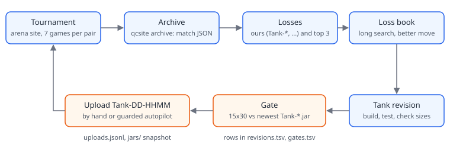
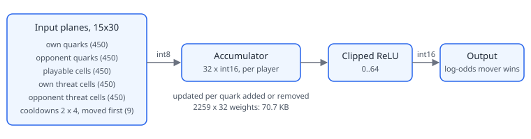
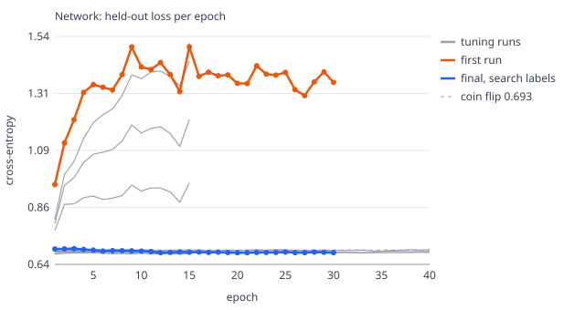
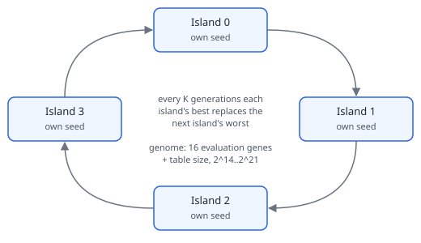
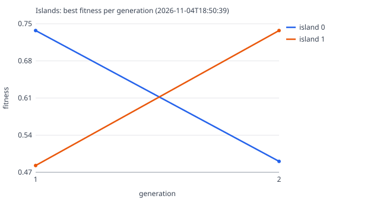

# How SerenaBot learns

SerenaBot is the QuantumConnect bot of team WilyQuarks. This page explains, for readers who don't
know our code, how it plays and how it improves between tournament rounds. Figures are in
`docs/figures/`. The charts are drawn from the TSVs in `arena/results/` by `uv run tools/figures.py`.
Every number below comes from those logs or from a tool's output, and an empty log is called empty.

## 1. Game model and search

The game is Connect-4 with extra steps: six in a row wins, and every tenth own turn a player may
drop a bomb that clears the 3×3 around its quark. The quarks above the gap then fall. The arena
currently plays a 15×30 field, and the bot rebuilds its model to whatever size it is given.

- **Model.** SerenaBot keeps its own fast board that it can undo. For every run of six cells (a
  *line*) it counts each player's quarks and updates the counts quark by quark. The win test, the
  evaluation and the threats all come from these counts. A threat is an empty cell that would
  complete a line. A bomb is carried out as a series of single-quark removals and additions. The
  rules are the engine's: `./qc.sh conformance` replays real engine games on the model.
- **Evaluation.** A line open to only one player is worth a weight to that player. The weight
  depends on how many quarks the line holds and on its direction. A player whose bomb is ready while
  the opponent's isn't gets a small bonus.
- **Search.** Negamax with alpha-beta, deepened one ply at a time until the move's 40 ms are
  used up (the arena allows 100 ms). A transposition table of 2^19 entries (about 8 MB) remembers
  positions already searched. Moves are tried in this order: the table's move, then moves that caused
  cut-offs before, then the centre columns. Threats force moves.

## 2. The learning loop

`./qc.sh tank` runs one turn of the loop:

1. **Archive.** `qcsite archive` saves our matches from the site. Saving them first matters because
   a re-upload deletes our old matches. If the site can't be reached, the loop carries on with the
   matches it already has.
2. **Losses.** `archive-losses` collects the games lost by `Tank-*`, `SerenaBot-*` and `QuarkBot-*`,
   and those of the current top 3.
3. **Loss book.** The bot replays each lost game and searches every one of its moves before the loss
   with far more time than a turn allows. When that search finds a clearly better move, the position's
   hash and the better move go into the book. In a game, a position found in the book is answered
   without searching.
4. **Tank revision.** Build, test and `./qc.sh check`, which scans the JAR for forbidden APIs and
   prints its sizes.
5. **Gate.** The candidate plays the newest `jars/Tank-*.jar` on 15×30 (10 games by default). The
   result is added to `arena/results/gates.tsv`, and the revision is added to
   `arena/params/serena/revisions.tsv`.
6. **Upload.** The loop prints the upload command but never runs it. The MCP tool `upload_bot` uploads
   only a `Tank-DD-HHMM` name that is confirmed by repeating it exactly and that passes the check. It
   archives first, then logs the upload to `arena/archive/uploads.jsonl` and keeps a copy in `jars/`.
   `qcsite autopilot` proposes an upload only when we are not first. It picks a revision that scored
   at least 60% over at least 20 gate games, and it uploads only when given `--yes`.

**What the logs hold so far.** `revisions.tsv` has no rows yet. `gates.tsv` has one test row, in which
the bot played a copy of itself:

| candidate | opponent | games | W-D-L | score |
|---|---|---|---|---|
| Tank-04-1852 | Tank-04-1851 | 10 | 3-0-7 | 0.300 |

A 10-game gate is this noisy even against an identical bot. That is why the autopilot asks for at
least 20 games. The loss book holds 184 entries.

## 3. Input planes

Network features are built from the side to move's point of view. On 15×30 they come to 2,259 bits:
five planes of 450 cells each, plus 9 extra bits.

| Plane | Bits |
|---|---|
| own quarks, opponent quarks | 450 + 450 |
| playable cells (where the next quark in each column would land) | 450 |
| own threat cells, opponent threat cells | 450 + 450 |
| bomb cooldown in 4 buckets, for each player | 4 + 4 |
| the mover moved first | 1 |

`./qc.sh dataset` replays all 301 archived 15×30 matches and writes 23,668 positions with the result
for the mover. Results are few and noisy labels: one blunder decides the label of every earlier
position in the match. So `./qc.sh dataset --search 120 --self-play 48 --threads 16` also labels
every position with SerenaBot's own score after a 120 ms search, using the line weights. It also adds
48 games of SerenaBot against itself, each from a random opening of 2 to 8 drops, and every move in
them is searched once: the search both labels the position and picks the move. That run wrote
34,891 positions (11,223 from self-play) in 282 s. Its searches reached a mean depth of 4.57 plies.
A move in a real game, at 40 ms on one thread, reaches 4.46. A larger run takes, by the tool's own
estimate, 13 minutes per 100k positions at 120 ms, or 54 minutes at 480 ms (roughly one ply deeper).

## 4. Network and memory

The network is NNUE-style. The input bits feed an accumulator of 32 int16 units, then a clipped ReLU,
then one output: the log-odds that the mover wins. An added or removed quark changes only a few
inputs, so the bot updates the accumulator as quarks come and go and doesn't recompute it. It saves
and restores the accumulator around a bomb. The trainer, in `tools/qc-net`, trains in floating point
and then quantises the weights (input weights to int8, scale 64). It mirrors positions left to right
and holds out 10% of the matches.

The first run learned whole matches by heart: its held-out loss rose to 1.50 by epoch 30, worse than a
coin flip (0.693). Weight decay alone (up to 3) only brought that peak down to 0.96. The fix was to
change the training target. It is now the game result pulled towards a
draw the further the position is from the end (horizon 20 plies). The four earliest runs used the
plain result, so their curves aren't directly comparable with the later ones.

That network, trained on results alone, has a held-out loss of 0.682 (quantised) and calls 64.6% of
decisive games right, only slightly better than a coin flip.

**Search labels.** The current network trains on a blend of two labels, as NNUE trainers do:
0.7 × the search label + 0.3 × the faded result. The search label is the search score turned into a
probability, 0.5 + c × (sigmoid(score / s) − 0.5). The trainer fits s and c to the game results of
the training positions. It found s = 891 score units per unit of log-odds, and c = 0.5, the lowest
value it tries: even a search that sees a forced win is not always right about the game, because
players blunder. The loss on these soft targets has a floor above zero, so the newest curve in the
chart isn't comparable with the older ones either. The trainer therefore also scores each network on
the old measure: held-out archived positions against the faded result. On that measure the new
network scores 0.674 (63.3% of decisive games right), against 0.682 (64.6%) for the network it
replaced. Weight decay 3 suited the noisy labels. With search labels, less decay does better: decay 3,
1, 0.3, 0.05 and 0 gave 0.683, 0.679, 0.676, 0.674 and 0.675. With 64 hidden units the result was
0.677, no better, so the network stays at 32. Generating the data (282 s) and training (16 s)
together take about 5 minutes.

**Speed.** With the network on, the bot searches 1.21M nodes/s against 1.71M off, 29% slower, and
reaches a mean depth of 4.21 plies against 4.46 in 40 ms (`./qc.sh network 40 40`). The two players'
accumulators now share one array, and each quark or threat adds one precomputed double row, in a
loop the JIT can vectorise; before that the gap was 32%. We also tried ordering moves by the
network's value of each child, after the table's move. Done from 3 plies above the horizon, it cut
speed to 1.11M nodes/s and depth to 4.11. From 5 plies it made no difference (4.18 against 4.20). So
it was dropped. With the network embedded the JAR is 1056 KB (1040 KB with the previous weights,
which compressed better), and the precomputed rows take about 0.25 MB of heap.

**Gate.** SerenaBot with the network played SerenaBot without it on 15×30: 40 games from random
4-ply openings, each opening played once with each colour, at the real 40 ms per move
(`./qc.sh stats` with the entrants `serena+net` and `serena`). The network won 10 games and lost 30,
a score of 25%. A distilled copy of the line weights' search, evaluated 29% slower, plays worse than
the line weights themselves. The network therefore stays **off by default** (`useNetwork = false`).

## 5. Island evolution

`./qc.sh tune --islands N --migrate K` evolves a genome of 17 genes: the 16 evaluation numbers (the
line weights stored as logarithms, plus the bomb bonus) and one structural gene, the table size
(2^14 to 2^21 entries). Each island starts from Serena's constants with its own seed. Fitness is the
score against the untouched SerenaBot, from random openings with both colours, at the real time limit,
minus 0.002 per MB of table. Each generation keeps the top quarter and fills the rest with mutated
crossovers of the better half. Every K generations the islands migrate in a ring.

Only a smoke test has run so far: 2 islands, 2 generations, 3 genomes each, on 8×12. With that few
games the curve shows only that the tool works, not that anything improved. A full 15×30 run is
estimated at 7–8 minutes and has not been run.

## 6. Budgets

| Budget | Limit | Now |
|---|---|---|
| Move time | 100 ms (arena) | 40 ms per move; an eighth of that after 20 s in a match |
| Program memory | 80 MB (ours, below the arena's) | about 12 MB heap; check fails above 60 MB |
| Upload JAR | tracked per revision | 1001 KB; 1056 KB with the network embedded |
| Network | grows only when it wins games | 32 hidden units, 70.7 KB of weights |

`./qc.sh check` prints a size line for each JAR, for example
`class=24KB book=184 params=29 heap=12MB jar=1001KB`. A revision goes into `revisions.tsv` with its
sizes, so any growth shows up there. Growth has to pay for itself in games played at the real time
limit.
